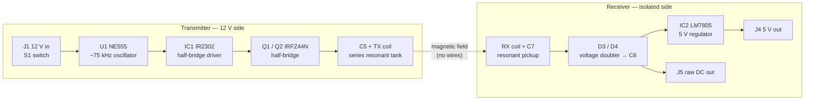

# Electromagnetic Coupling Link — Resonant Inductive Power Transfer

A KiCad 8 project for a **wireless power link**: a 12 V transmitter drives a tuned coil at ~75 kHz, and a galvanically isolated receiver coil picks up the field, rectifies it and regulates it to **5 V**. It uses only common through-hole parts (NE555, IR2302, IRFZ44N, LM7805).

> Full-page schematic: [`EM_Coupling/EM_Coupling.pdf`](EM_Coupling/EM_Coupling.pdf)

---

## Contents

- [How it works](#how-it-works)
- [Key design values](#key-design-values)
- [Bill of materials](#bill-of-materials)
- [Coils](#coils)
- [Expected performance](#expected-performance)
- [Repository layout](#repository-layout)
- [Opening the project](#opening-the-project)
- [Regenerating the files](#regenerating-the-files)
- [Verification](#verification)
- [Safety notes](#safety-notes)
- [Project status](#project-status)

---

## How it works



### Transmitter (12 V)

| Stage | Parts | What it does |
|---|---|---|
| Power input | J1, S1, C8, C1 | 12 V DC in, on/off switch, input and high-frequency decoupling |
| Oscillator | U1, R1, R4, C11, C10, C2 | NE555 astable, ~75 kHz square wave, ~53 % duty |
| Gate driver | IC1, R2, C4, D2, C3 | IR2302 drives the half-bridge with built-in dead time; D2/C3 bootstrap the high-side gate |
| Power stage | Q1, Q2, R3 | IRFZ44N half-bridge switches the `SW` node between 12 V and GND |
| Resonant tank | C5, TX coil (J2) | Series LC tuned to 75 kHz — a large AC current flows in the coil and makes a strong alternating magnetic field |

### Receiver (isolated)

| Stage | Parts | What it does |
|---|---|---|
| Pickup | RX coil (J3), C7 | Coil tuned to the same 75 kHz so it captures as much energy as possible |
| Rectifier | D3, D4, C6 | Greinacher voltage doubler: about 2× the coil peak voltage as DC (`VRAW`, also on J5) |
| Regulator | IC2, C9 | LM7805 gives a steady 5 V on J4 |
| Protection | D5, D1 | D5 protects the 7805 when C6 discharges first; D1 (5.6 V zener) clamps output over-voltage |

The TX ground (`GND`) and RX ground (`GND_RX`) are **not connected**. Energy crosses only through the magnetic coupling between the two coils.

---

## Key design values

| Quantity | Formula | Value |
|---|---|---|
| Oscillator frequency | f = 1.44 / ((R1 + 2·R4) · C11) | 1.44 / ((1 k + 18.18 k) · 1 nF) ≈ **75 kHz** |
| Duty cycle | (R1 + R4) / (R1 + 2·R4) | ≈ **53 %** |
| Coil inductance for resonance | L = 1 / ((2π f)² · C) with C5 = C7 = 0.1 µF | ≈ **45 µH** per coil |
| Minimum `VRAW` for regulation | 5 V + LM7805 dropout | ≈ **7.5 V** |

---

## Bill of materials

| Reference | Value | Footprint | Qty | Notes |
|---|---|---|---|---|
| C1, C2, C3, C4, C5, C7, C9 | 0.1 µF | `Capacitor_THT:CP_Radial_Tantal_D6.0mm_P5.00mm` | 7 | **C5 and C7: use film, ≥ 250 V** (see notes below) |
| C6 | 470 µF | `Capacitor_THT:CP_Radial_Tantal_D7.0mm_P5.00mm` | 1 | Reservoir, ≥ 25 V |
| C8 | 0.33 µF | `Capacitor_THT:CP_Radial_Tantal_D7.0mm_P5.00mm` | 1 | 12 V input bypass |
| C10 | 10 nF | `Capacitor_THT:CP_Radial_Tantal_D6.0mm_P5.00mm` | 1 | 555 CV filter |
| C11 | 1 nF | `Capacitor_THT:CP_Radial_Tantal_D6.0mm_P5.00mm` | 1 | 555 timing (C0G/film recommended) |
| D1 | 1N5919BG | `3D_Models:DIOAD1405W86L465D235` | 1 | 5.6 V / 3 W zener |
| D2, D3, D4, D5 | 1N4148 | `3D_Models:DIOAD1068W53L380D172` | 4 | |
| IC1 | IR2302SPBF | `3D_Models:SOIC127P600X175-8N` | 1 | Half-bridge driver |
| IC2 | LM7805CT | `3D_Models:TO254P470X1028X1955-3P` | 1 | 5 V regulator |
| J1–J5 | 282843-2 (TE) | `3D_Models:SHDR2W130P0X1016_1X2_1524X900X1550P` | 5 | 12 V in, TX coil, RX coil, 5 V out, raw DC out |
| Q1, Q2 | IRFZ44NPBF | `3D_Models:TO254P483X1016X1994-3P` | 2 | N-MOSFET, TO-220 |
| R1 | 1 kΩ | `Resistor_THT:R_Axial_DIN0204_L3.6mm_D1.6mm_P7.62mm_Horizontal` | 1 | 555 R_A |
| R2 | 100 Ω | same | 1 | Driver input |
| R3 | 10 Ω | same | 1 | Q1 gate |
| R4 | 9.09 kΩ | same | 1 | 555 R_B |
| S1 | EG1218 | `3D_Models:EG1218` | 1 | SPDT slide switch |
| U1 | NE555P | `Package_DIP:DIP-8_W7.62mm` | 1 | Timer |

**Not in the BOM:** the two coils, about 45 µH each (see [Coils](#coils)).

> **Capacitor notes.** The BOM footprints for all capacitors are radial tantalum. That's fine for the DC parts, but **C5 and C7 carry the resonant AC current**, and the voltage across them can exceed 100 V at resonance. Fit polypropylene film capacitors rated **≥ 250 V** there; the 5 mm-pitch footprint fits most 0.1 µF film parts. The KiCad symbol for Q1/Q2 is `IRF540N` (same G-D-S TO-220 pinout), with its value set to IRFZ44NPBF.

A machine-readable BOM is in [`EM_Coupling/EM_Coupling_BOM.csv`](EM_Coupling/EM_Coupling_BOM.csv).

---

## Coils

Both coils are the same design, about **45 µH**, so they resonate at 75 kHz with 0.1 µF.

- Starting point: about **15 turns of 0.8–1.0 mm enamelled copper wire** (or Litz wire) on a **60 mm** diameter former, flat or short solenoid.
- Measure with an LCR meter and adjust turns. If your coil differs, retune: C = 1 / ((2π · 75 kHz)² · L).
- Fine-tune by trimming C5/C7, or adjust R4 to move the oscillator onto the tank's actual resonance.

---

## Expected performance

These are design estimates, not measured results.

| Parameter | Estimate |
|---|---|
| Operating frequency | ~75 kHz |
| Coupling distance | ~1–5 cm (60 mm coils, coaxial) |
| Output | 5 V regulated, roughly 0.3–0.5 W |
| Output current limit | ~100 mA (set by the 1N4148 rectifiers) |

For more output power, replace D3/D4 with faster, higher-current diodes (e.g. UF4001 or 1N5819 Schottky) and raise C6's voltage rating to suit.

---

## Repository layout

```
.
├── README.md
├── docs/
│   └── schematic.svg            # schematic image used in this README
├── EM_Coupling/                 # KiCad 8 project
│   ├── EM_Coupling.kicad_pro
│   ├── EM_Coupling.kicad_sch    # fully wired schematic
│   ├── EM_Coupling.kicad_pcb    # starter PCB: footprints and nets, not routed yet
│   ├── EM_Coupling.pdf          # printable schematic
│   ├── EM_Coupling.net          # exported netlist
│   ├── EM_Coupling_BOM.csv      # exported BOM
│   ├── erc.rpt                  # latest ERC report
│   ├── fp-lib-table             # project footprint library table
│   ├── 3D_Models.pretty/        # project-local SamacSys footprints
│   └── 3D_Models.3dshapes/      # matching STEP models
├── gen_wired.py                 # generates the wired schematic (main generator)
├── gen_schematic.py             # older label-based generator (kept as netlist reference)
├── labels_reference.net         # reference netlist used to check the wired schematic
├── kicad_lib.py                 # helper: reads KiCad symbol libraries
└── build_pcb.py                 # builds the starter PCB using KiCad's pcbnew Python
```

---

## Opening the project

1. Install **KiCad 8.0** or newer.
2. Open `EM_Coupling/EM_Coupling.kicad_pro`.
3. The project ships its own footprint library table (`fp-lib-table`). The nickname `3D_Models` resolves to `EM_Coupling/3D_Models.pretty`, so no global library setup is needed.

---

## Regenerating the files

The schematic and PCB are generated by scripts, so values and layout can be changed in code and rebuilt.

```bash
python gen_wired.py
```

```bash
"<KiCad>/bin/python.exe" build_pcb.py
```

The first command needs Python 3.9+; `kicad_lib.py` reads the symbol libraries from the KiCad install path set at the top of the file. The second must run with **KiCad's bundled Python**, because it uses the `pcbnew` module.

Run ERC and export outputs with `kicad-cli`:

```bash
kicad-cli sch erc --severity-all -o EM_Coupling/erc.rpt EM_Coupling/EM_Coupling.kicad_sch
```

```bash
kicad-cli sch export pdf -o EM_Coupling/EM_Coupling.pdf EM_Coupling/EM_Coupling.kicad_sch
```

---

## Verification

- **ERC:** 0 errors, 0 warnings (`EM_Coupling/erc.rpt`).
- **Netlist check:** the wired schematic's connectivity was compared pin-for-pin against an independently generated reference netlist (`labels_reference.net`). All 20 nets are identical.
- **Footprints:** every schematic pin maps to a footprint pad with the same number, with no missing or extra pads, for all footprints that load (see status below).
- **Not done yet:** no SPICE simulation, PCB routing or bench testing.

---

## Safety notes

- **Use a current-limited bench supply** (start at 0.5–1 A). With no receiver nearby, a series-resonant transmitter can draw a very large current and overheat the MOSFETs and coil.
- **High voltage at resonance:** C5/C7 and the coils can see over 100 V peak, even from a 12 V supply. Don't touch the tank while it's running.
- The MOSFETs and 7805 may need heatsinks at higher power.
- Keep the transmitter coil away from metal objects, which heat up in the field, and from sensitive electronics.

---

## Project status

- [x] Circuit design using the given BOM
- [x] Fully wired KiCad schematic, ERC clean
- [x] Footprints assigned per BOM; project-local footprint library with 3D models
- [x] Starter PCB with 25 of 31 footprints and their nets
- [ ] **Footprints for S1 (`EG1218`) and J1–J5 (`SHDR2W130P0X1016_1X2_1524X900X1550P`)** still need adding to `EM_Coupling/3D_Models.pretty`
- [ ] PCB placement and routing (keep the TX/RX isolation gap)
- [ ] Wind coils and tune resonance
- [ ] Bench test and measure efficiency and range

---

## Credits

- Footprints and 3D models for 1N4148, 1N5919BG, IR2302SPBF, IRFZ44NPBF and LM7805CT come from **SamacSys / Component Search Engine**. Check their terms before redistributing them in a public repository.
- Symbols and the remaining footprints are from the standard **KiCad** libraries.

## License

MIT License

Copyright (c) 2026 B M Sadman Showmi
